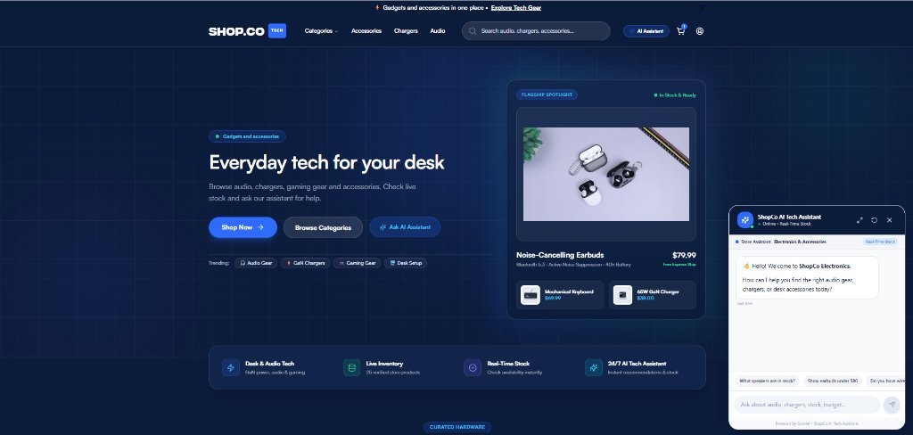

[](https://github.com/aleena-ather/shopco-sales-assistant)

# Shopco Tech

Shopco Tech is an e-commerce platform for electronics and accessories, featuring a real-time Google Sheets inventory integration and an intelligent AI Sales Assistant powered by Google Gemini. It utilizes **Next.js 14 App Router**, **TypeScript**, **Tailwind CSS**, **Redux**, **Framer Motion**, and **ShadCN UI** to deliver a modern, fast, and fully responsive shopping experience.

## Table of Contents

- [Overview](#overview)
- [Demo](#demo)
- [Features](#features)
- [Technologies](#technologies)
- [Installation](#installation)
- [Usage](#usage)
- [Author](#author)
- [License](#license)

## Overview

Shopco Tech combines modern e-commerce front-end development with conversational AI. The store connects directly to a live Google Sheets inventory and integrates an interactive AI Sales Assistant that answers customer product inquiries, filters items by budget, suggests in-stock alternatives for sold-out products, and guides users to product pages.

## Demo

Check out the live demo: [Shopco Tech Demo](https://shopco-sales-assistant.vercel.app/)

## Features

- **AI Sales Assistant**: Conversational assistant powered by Google Gemini for product recommendations, budget filtering, and live stock inquiries.
- **Live Inventory Synchronization**: Connected to Google Sheets API to fetch real-time stock availability and pricing.
- **Next.js 14**: Server-side rendering (SSR), Static Site Generation (SSG), optimized routing, and API integrations.
- **TypeScript**: Strongly typed code for better error detection and maintainability.
- **Tailwind CSS**: Utility-first CSS framework for rapid UI development.
- **Redux**: State management for managing the shopping cart and other global states.
- **Framer Motion**: Smooth animations and transitions for an enhanced user experience.
- **ShadCN UI**: Beautifully styled, accessible, and customizable UI components.
- **Fully Responsive**: Mobile-first design ensuring the layout adapts seamlessly across devices.
- **Performance Optimized**: Best practices followed for fast loading and interaction.

## Technologies

- **Next.js 14** - A popular React framework with built-in SSR and optimization.
- **Google Gemini** - Generative AI engine powering the conversational sales assistant.
- **Google Sheets API** - Real-time inventory and catalog data source.
- **TypeScript** - A superset of JavaScript for strong typing and code consistency.
- **Tailwind CSS** - A utility-first CSS framework for fast, responsive design.
- **Redux** - A state management library used for the shopping cart and global app state.
- **Framer Motion** - A library for animations and interactions in React.
- **ShadCN UI** - A collection of beautiful, accessible, and customizable UI components.

## Installation

To get started with Shopco locally, follow these steps:

1. **Clone the repository:**

   ```bash
   git clone https://github.com/aleena-ather/shopco-sales-assistant.git
   cd shopco-sales-assistant
   ```

2. **Install dependencies:**

   ```bash
   npm install
   ```

   ```bash
   yarn install
   ```

3. **Set up environment variables:**

   Create a `.env.local` file in the root directory (or copy from `.env.example`):

   ```bash
   cp .env.example .env.local
   ```

   Add your API keys and configuration in `.env.local`:

   ```env
   GEMINI_API_KEY=your_gemini_api_key
   GEMINI_MODEL=gemini-3.1-flash-lite
   GOOGLE_SHEET_ID=your_google_sheet_id
   GOOGLE_SERVICE_ACCOUNT_KEY_FILE=your_service_account.json
   SUPPORT_EMAIL=support@example.com
   ```

4. **Run the development server:**

   ```bash
   npm run dev
   ```

   ```bash
   yarn dev
   ```

5. **Open in your browser:**  
   Navigate to [http://localhost:3000](http://localhost:3000) to view the app.

## Usage

- To explore or modify the code, navigate through the `src/components`, `src/lib`, and `src/app` directories.
- The AI Sales Assistant logic is located in `src/app/api/chat` and `src/components/chat/GeminiChatWidget.tsx`.
- The shopping cart logic is managed using **Redux**. You can find the store configuration and cart actions in the `src/lib/features` directory.
- Google Sheets inventory integration is configured in `src/lib/sheets.ts`.
- **ShadCN UI** components are used across the app and can be customized in the `src/components/ui` directory.

## Author

- **Aleena Ather** — [@aleena-ather](https://github.com/aleena-ather)

## License

This project is licensed under the MIT License.
